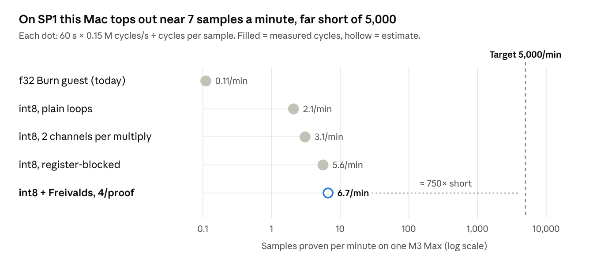

# Zk-FedEval: Faster Proving on One M3 Max (No External GPU)

Oct 9, 2026 · @Okeke Francis

## Summary

With SP1 on the CPU alone, this M3 Max has gone from not finishing a single proof to 3.1 samples a minute, measured with 4-sample proofs on AC (2.4 on battery). That is still \~1,600× short of 5,000 a minute, and the SP1 levers that remain are small. Closing the rest on this one machine needs a prover built for neural networks, or a statistical audit instead of proving every sample.

- **Rewrite the guest (biggest win).** Integer kernels cut cycles 51× (measured: 81.5 M → 1.60 M per sample), taking the Mac to \~3.1 samples/min with 4-sample proofs on AC (\~2.4 on battery). Freivalds checking now looks like only \~1.25× at that batch size, so it's deprioritized.
- **Tune the prover (small win).** A warm prover process, big batches, and compressed proofs remove \~30–45 s of overhead per run but add little throughput. Memory is the real wall: proofs peak at \~46 GB on a 36 GB machine whatever the shard settings.
- **Change provers (the only route to thousands a minute).** A sumcheck-based zkML prover such as DeepProve, or RISC Zero with Metal (which uses the Mac's built-in GPU). Both now benchmarked here: RISC Zero is \~28× slower than SP1 and ruled out. DeepProve proves a same-architecture CNN inference in \~0.3–0.4 s (roughly 150 samples/min on one Mac, est.), but its license is evaluation-only and its proofs need a new on-chain verifier.
- **Fallback: audit a random subset** over a longer window, accepting an accuracy figure that is within a few points instead of exact.

## Baseline on this Mac

The M3 Max proves at about 0.15 M RISC-V cycles per second, and each proof carries \~30 s of fixed overhead. Today's guest needs 81.5 M cycles per sample, and even a one-sample proof runs out of memory (killed at a 56.5 GB peak, measured later the same day).

Measured on 2026-10-09: SP1 6.6 CPU prover, 14-core M3 Max with 36 GB, on AC power, using a stand-in model with the same shape as `Net`.

| Measurement                                | Value                                               |
| ------------------------------------------ | --------------------------------------------------- |
| Client start-up (`ProverClient` build)     | \~13 s per process                                  |
| Core proof, 1 int8 sample (3.7 M cycles)   | 56 s                                                |
| Core proof, 4 int8 samples (12.5 M cycles) | 113 s                                               |
| Marginal proving rate                      | \~0.15 M cycles/s                                   |
| Fixed time per proof                       | \~30 s                                              |
| Compressed vs core, 1 sample               | 56.6 s vs 56.2 s                                    |
| CPU use during proving                     | \~8 of 14 cores busy (1,001 s user over 123 s wall) |
| Peak memory footprint, 4-sample proof      | \~46 GB, above the 36 GB of RAM                     |
| Proofs of 16+ samples                      | Killed silently, most likely for memory             |

Three things limit this Mac, in order:

1. **Cycles per sample.** Float math is emulated at \~120 cycles per multiply-add.
2. **Memory.** A 4-sample proof already needs more memory than the Mac has, and shard settings don't change that. Larger batches died.
3. **Fixed overhead.** About 30 s per proof plus 13 s per process, which dominates small batches.

## Fewer cycles per sample: the lever that matters most

Cutting guest cycles is the only change that moves this Mac by orders of magnitude: from not finishing a proof to 3.1 samples a minute on AC, measured. Even so it is \~1,600× short of 5,000.

_Cycle counts measured 2026-10-09 (SP1 6.6 executor), estimates marked; rate = measured M3 Max CPU rate._

The guest changes are the same ones in the [GPU speedup plan](PROVING_SPEEDUP_PLAN.md): int8 quantization, plain loops instead of Burn, packing two channels per 64-bit multiply, and checking layer outputs with Freivalds' test instead of recomputing them. They help a CPU exactly as much as a GPU, because proving time scales with cycles on both.

These rates assume big batches, so the \~30 s fixed cost per proof is amortized. The next section covers what limits batch size on this Mac.

## Make the CPU prover itself faster

Tuning the prover is worth having, but probably less than 2× combined, against \~160× from the guest. Its main job is making large batches possible and cutting the per-run overhead.

| Lever                    | What to do                                                                                    | Expected effect                                                                                                                                           | Evidence                                 |
| ------------------------ | --------------------------------------------------------------------------------------------- | --------------------------------------------------------------------------------------------------------------------------------------------------------- | ---------------------------------------- |
| Warm prover service      | Build `ProverClient` once, keep proving keys in memory, and feed it jobs from a queue         | Saves \~13 s start-up plus setup on every run                                                                                                             | Measured start-up                        |
| Bigger batches per proof | Prove as many samples per proof as memory allows                                              | Amortizes \~30 s fixed per proof; at 4 int8 samples, fixed cost is about half the time                                                                    | Measured: 56 s @1, 113 s @4              |
| Shard settings           | `SHARD_SIZE`, `ELEMENT_THRESHOLD`, `HEIGHT_THRESHOLD`, `TRACE_CHUNK_SLOTS` (SP1 6.6 env vars) | **No help.** Peak stayed at 45.6–46.8 GB against 45.8 GB at defaults, and time moved by 4% or less. The \~46 GB looks like a fixed cost of the CPU prover | Measured                                 |
| Two provers side by side | Run a second process on another chunk to use the \~6 idle cores                               | Up to \~1.5×, but only if memory allows, which it doesn't yet                                                                                             | Estimate                                 |
| Build flags              | `RUSTFLAGS="-C target-cpu=native"`, `lto = "fat"`, `codegen-units = 1` for the host           | Likely single-digit percent                                                                                                                               | Estimate                                 |
| Power settings           | Stay on AC, keep Low Power Mode off, and use High Power Mode if your model offers it          | Measured: a 4-sample proof takes \~76 s on AC vs \~100 s on battery                                                                                       | General macOS behavior                   |
| Proof mode               | Use compressed proofs while iterating; wrap one aggregate in Groth16 at the end               | Skips the Groth16 step per batch; its CPU cost here is unmeasured                                                                                         | Measured: compressed ≈ core at this size |
| Free memory              | Quit browsers and other heavy apps while proving                                              | Less swapping at \~46 GB peak                                                                                                                             | Inference from the measured footprint    |

## Beyond SP1 on a Mac

On one Mac, 5,000 samples a minute needs either a prover built for neural networks or a weaker, statistical guarantee. SP1's CPU prover can't close a \~1,600× gap with tuning alone.

| Option                                                                                     | Why it might work on an M3 Max                                                                                                                                                                   | What it costs                                                                                                                                | Status                                                                                                                                                                                                            |
| ------------------------------------------------------------------------------------------ | ------------------------------------------------------------------------------------------------------------------------------------------------------------------------------------------------ | -------------------------------------------------------------------------------------------------------------------------------------------- | ----------------------------------------------------------------------------------------------------------------------------------------------------------------------------------------------------------------- |
| Sumcheck/GKR zkML prover, such as [DeepProve](https://github.com/Lagrange-Labs/deep-prove) | Proves matrix products directly instead of emulating a CPU. Its README reports GPT-2 (512 tokens) in 7.6 min on one CPU machine: very roughly 100 M+ multiply-adds/s, against our need of 55 M/s | Proofs are MBs, not a 260-byte Groth16, so PolkaVM verification needs a new verifier or an SP1 wrap. CNN layer support needs checking        | Measured on a same-architecture CNN: \~1.1 s per inference end to end (\~0.3–0.4 s proving), 175 MB peak. Fastest option by far, but the license is evaluation-only, so production use needs Lagrange's agreement |
| [RISC Zero](https://github.com/risc0/risc0) zkVM                                           | Its README says Metal GPU acceleration is on by default on Apple Silicon, so it uses the M3 Max's built-in GPU. The int8 guest is plain Rust and ports easily                                    | A second zkVM and a different on-chain verifier. Throughput on this guest is unknown                                                         | Benchmarked: \~28× slower than SP1 here (35.6 min for 4 samples); ruled out                                                                                                                                       |
| Audit a random subset                                                                      | Commit to all samples, then prove only _k_ indices chosen by randomness revealed after the commit                                                                                                | A statistical answer. At \~2.4 proofs/min, an hour (\~144 proofs) gives ±11 points at 95% (Hoeffding), and a day (\~3,400) gives ±2.3 points | Easy to add on top of any prover                                                                                                                                                                                  |

The Mac's built-in GPU can't speed up SP1: SP1's GPU prover is CUDA-only. If the M3 Max's GPU is to help, it has to be through a prover with a Metal backend, such as RISC Zero.

The zkML numbers are the vendor's, for a transformer, on a CPU machine the README doesn't specify. Treat the 100 M/s figure as an order of magnitude to test, not a promise.

## Step-by-step plan

Do the guest work first, since it gives \~28× for certain. Tune the prover second. Spike the alternative provers in parallel, because they are the only route to thousands per minute on this machine.

1. **Bring the int8 guest into the repo.** Quantize in Python, write the guest as plain loops, and add a bit-exact native Rust twin. _Status: implemented on branch `mac-int8-proving`. 1.60 M cycles/sample after loop tuning and register blocking (gate met); on a trained model, accuracy is unchanged (18.97% vs 18.93%) but top-1 agreement is 97.6%, below the 99% gate._
   - Measure: cycles per sample ≤ 3 M, and top-1 agreement with the `f32` model ≥ 99%.
   - Expected on this Mac: \~3 samples/min, up from \~0.1.
2. **Run a long-lived prover service.** Build the client once, keep proving keys in memory, and prove compressed, not Groth16. _Status: implemented in the host (`ZK_FEDEVAL_NUM_BATCHES`, `ZK_FEDEVAL_PROOF`); ran end to end on real data: 3 compressed 4-sample proofs in one process, setup paid once (13 s client start + 0.9 s setup), 130–134 s per proof on battery._
   - Measure: time per proof minus cycles ÷ rate, which is the fixed overhead (\~30 s today).
3. **Keep each proof to 4 samples or fewer.** Proof memory grows with cycles per proof: 26.7 GB at 1 int8 sample, 42.3 GB at 4. So prove many small batches in one warm process and aggregate them, rather than chasing bigger batches. _On expert advice, the 16-sample failure isn't being investigated further._
   - Measure: samples/min over a run of several 4-sample batches.
4. **Apply build and power settings.** Use `target-cpu=native` with fat LTO, stay on AC, keep Low Power Mode off, and quit memory-heavy apps. Status: measured, no gain from target-cpu=native (153.9 s vs 152.4 s for two 4-sample proofs on AC). Power matters more: \~76 s per proof on AC vs \~100 s on battery.
   - Measure: change in cycles/s against step 3.
5. **Try two provers side by side** on separate chunks, if memory allows. _Status: ruled out on 36 GB, since one 4-sample proof already peaks at 42 GB._
   - Measure: combined samples/min.
6. **Add Freivalds hint checking.**
   - Measure: cycles per sample ≤ 0.6 M.
   - _Status: deprioritized after measuring._ conv1, with only 6 output channels, is 58% of the cycles and gains little. With at most 4 samples per proof, the per-proof `r·W` setup (\~0.4 M cycles) doesn't amortize. Net \~1.25×, so this only pays on the GPU path, where batches are large.
7. **Spike DeepProve and RISC Zero (Metal)** on the same int8 CNN, one day each, at any point. Status: RISC Zero done and ruled out. It needs 5.7 M cycles per sample (it's 32-bit, so the 64-bit packed multiplies cost more), and a 4-sample proof took 2,134 s (35.6 min) with the Metal-enabled r0vm 3.0.3, about 28× slower than SP1. DeepProve: its CNN benchmark tool failed on our model, on a bug in its float-accuracy step that the license forbids patching. Its own test, though, proves and verifies one inference of a same-architecture CIFAR CNN (62k parameters) in \~1.1 s end to end, \~0.3–0.4 s of it proving, at a 175 MB peak. That is roughly 50–100× SP1 on this Mac. Blockers: the license is evaluation-only, and its proofs aren't Groth16, so verifying on PolkaVM needs new work.
   - Measure: samples/min, proof size, and the path to verifying on PolkaVM.
   - Switch if either beats step 6 by 10× or more.
8. **If you're still short, audit a random subset** over a longer window instead of proving every sample.
