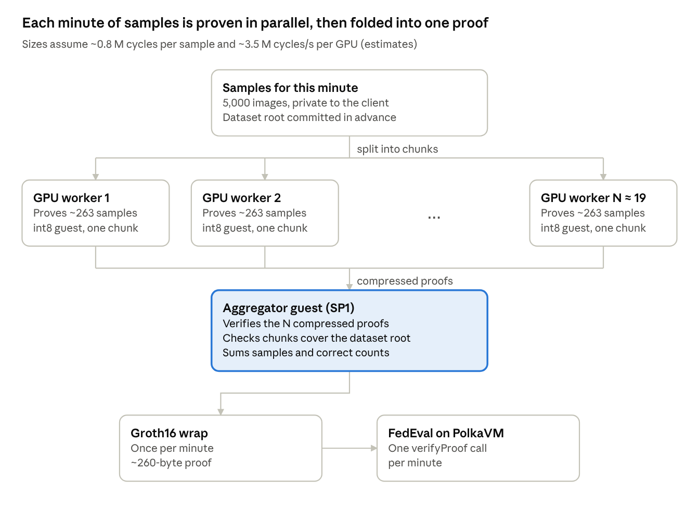
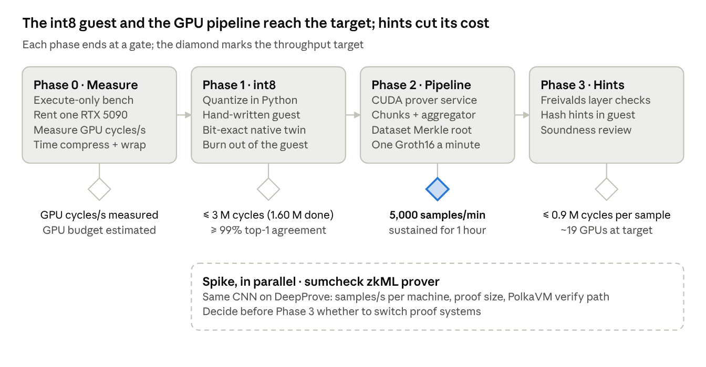

# Zk-FedEval: Proving Speedup Plan (Target 5,000 Samples/Min)

Oct 9, 2026 · @Okeke Francis

## Summary

Hitting 5,000 samples a minute (83 per second) means cutting the zkVM work per sample about 50–100×, then proving on a GPU pool with one Groth16 proof per minute instead of one per batch.

- **Today:** the guest spends **81.5 M RISC-V cycles per sample**, plus 32 M fixed per proof (measured). At 83 samples/s that is 6.8 billion cycles/s of proving, roughly 1,900 RTX 5090s. Throwing hardware at it doesn't work.
- **Why:** inference runs in `f32` through Burn's `ndarray` backend. SP1 has no floating-point unit, so every multiply-add is emulated in software.
- **Lever 1, integer kernels (measured, implemented):** the same CNN in int8, with two output channels per 64-bit multiply and a register-blocked conv kernel, costs **1.60 M cycles per sample**, 51× less. That brings the pool to about 38 GPUs.
- **Lever 2, check instead of compute (estimated):** feed layer outputs in as hints and check them with Freivalds' random-vector test. Revised after measuring per-layer cost: \~0.8 M cycles per sample, about 19 GPUs. conv1 is 58% of the cycles and has only 6 output channels, so it gains least.
- **Lever 3, prove in parallel and aggregate:** split each minute's samples into chunks, prove the chunks concurrently, fold them recursively, and pay for one Groth16 wrap per minute.
- **Fallbacks:** a sumcheck-based zkML prover, or proving a random audited subset instead of every sample.

GPU counts here use a rough \~3.5 M cycles/s per RTX 5090, derived from Succinct's published numbers. Measuring that rate on our own guest is the first task in the roadmap.

## Where the time goes today

One sample costs \~81.5 M cycles. On an M3 Max even a one-sample proof doesn't finish: it is killed at a 56.5 GB memory peak. The target allows 12 ms per sample.

All figures were measured on 2026-10-09 with SP1 6.6 on a 14-core M3 Max (36 GB), using a stand-in model with the same shape as `Net` and random weights.

| Measurement                                           | Value                                                     |
| ----------------------------------------------------- | --------------------------------------------------------- |
| `f32` guest, 1 sample                                 | 113.9 M cycles                                            |
| `f32` guest, 16 samples (the default batch)           | 1.336 B cycles                                            |
| Per sample / fixed per proof                          | 81.5 M / 32 M cycles                                      |
| CPU core proof, int8 guest, 1 sample (3.7 M cycles)   | 56 s                                                      |
| CPU core proof, int8 guest, 4 samples (12.5 M cycles) | 113 s                                                     |
| Marginal CPU proving rate                             | \~0.15 M cycles/s                                         |
| Compressed vs core proof, 1 sample                    | 56.6 s vs 56.2 s                                          |
| Peak memory footprint, 4-sample proof                 | \~46 GB                                                   |
| Default 16-sample `f32` proof on this Mac             | Doesn't finish: even 1 sample is killed at a 56.5 GB peak |

**Floats cost \~120 cycles per multiply-add.** The CNN needs 0.66 M multiply-adds per image, and 81.5 M / 0.66 M ≈ 123 cycles each. The instruction mix (`ADDI`, `AND`, `LUI`, `SLL`, `OR`, `SRL`, compare-and-branch) is the bit-twiddling of software floating point: unpack, align, add, normalize, round. The int8 guest spends \~4.4 cycles per multiply-add.

**The 32 M fixed cycles are mostly model loading.** The weights get copied out of the binary, decoded from burnpack, and built into `f32` tensors on every run. The cycle tracker didn't report inside this build, so this split is inferred from the 1- vs 16-sample runs.

**Small proofs are mostly fixed overhead.** A 1-sample proof takes \~56 s whether core or compressed, so fixed prover overhead (\~30 s) dominates small proofs. Beyond that, time grows at \~0.15 M cycles/s.

**Memory limits a laptop.** The 4-sample proof peaked at \~46 GB, swapping on a 36 GB machine. Runs of 16 or more samples died silently, most likely killed by macOS under memory pressure. CPU proving here is a development loop, not a path to the target.

Not measured yet: the Groth16 wrap (it needs the `native-gnark` build) and any GPU rate. Both are Phase 0.

## Guest-side: make each sample cheaper

Proving cost scales with cycles, and two prototype guests already show a 28× cut with no change to SP1. Both run the same CNN shape (random weights; cycle counts don't depend on weight values) on the SP1 6.6 executor.

| Guest variant                                                                    | Cycles per sample | Fixed per proof | vs today | Status   |
| -------------------------------------------------------------------------------- | ----------------- | --------------- | -------- | -------- |
| `f32`, Burn `ndarray` backend (today)                                            | 81.5 M            | 32 M            | 1×       | Measured |
| int8, plain Rust loops                                                           | 4.30 M            | \~0.01 M        | 19×      | Measured |
| int8, two channels per 64-bit multiply                                           | 2.92 M            | \~0.01 M        | 28×      | Measured |
| int8 as implemented: unrolled, register-blocked conv (branch `mac-int8-proving`) | 1.60 M            | 0.51 M          | 51×      | Measured |
| + Freivalds hint checking                                                        | \~0.8 M (revised) | \~0.5 M         | \~100×   | Estimate |

**1. Quantize to int8 in Python, before proving.** Use per-channel int8 weights, u8 activations after ReLU, i32 accumulators, and a fixed-point rescale between layers. Fold the input normalization into `conv1`'s weights and bias so images enter as raw 0–255 pixels. The quantized model becomes the canonical one that gets proven and registered on chain. Gate it on top-1 agreement with the `f32` model on the client's test split, for example at least 99%.

**2. Drop Burn from the guest.** The CNN is five layers, about 150 lines of plain loops over `static` weight arrays. That removes tensor allocation and burnpack decoding, which is where the 32 M fixed cycles go.

**3. Send raw bytes.** Read pixels with `sp1_zkvm::io::read_vec()` as `u8`: 3 KB per sample instead of a 12 KB bincode `Vec<f32>`.

**4. Two multiply-adds per instruction.** Offset weights to unsigned (`w + 128`), pack two output channels as `lo | hi << 32`, and do one `u64` multiply per activation. Then subtract `128 × sum(window)` from each lane. Each lane's sum stays under 2^24, so no lane overflows into its neighbour. This is the 4.30 M → 2.92 M step.

**5. Check layer outputs instead of computing them (Freivalds).** The host computes every layer's integer output `Y = X·W` natively and passes it in as a hint. The guest hashes the hints, derives a random vector `r` from that hash, and checks `X·(W·r) == Y·r` in exact `i64` arithmetic. The check costs one multiply-add per input element instead of one per input × output channel: about 6× cheaper for `conv1`, 14× for `conv2`, and near free for the dense layers once `W·r` is shared across a batch. With 32-bit random entries, a wrong `Y` passes with probability at most 2^-32 per check, and running it twice gives 2^-64. ReLU, pooling, and rescaling are still computed in the guest from `Y`, which is cheap. The open cost is hashing \~25 KB of hints per sample with SP1's SHA-256 or keccak precompile, which has to be measured.

**6. Stop paying setup on every run.** `EvalProver::setup` rebuilds the proving key on every process start. Keep a long-running prover service or cache the key.

## Prover-side: faster hardware, fewer wraps

Once the guest is cheap, throughput comes from GPUs, and from paying the fixed Groth16 cost once per minute instead of once per batch.

**Move from CPU to CUDA.** `ProverClient::from_env()` already supports `SP1_PROVER=cuda` (the `cuda` feature in `sp1-sdk`). Succinct proves Ethereum blocks of over 600 M cycles in under 12 s on 16 RTX 5090s ([16-GPU post](https://blog.succinct.xyz/real-time-proving-16-gpus/), [Hypercube cycle count](https://www.theblock.co/post/355013/succinct-introduces-zkvm-sp1-hypercube-claims-real-time-ethereum-proving)). That works out to roughly 3–4 M cycles/s per GPU. It's a latency-tuned, precompile-heavy workload, so it's probably a conservative figure for our ALU-only guest.

**Scale out by running independent chunks.** Proving separate chunks is embarrassingly parallel: one prover process per GPU, each proving its own slice of the minute's samples. That avoids relying on multi-GPU sharding inside one proof.

**Wrap once per minute.** Each chunk ends as a _compressed_ proof, which is constant size and has no Groth16 step. An aggregator guest verifies those proofs with `sp1_zkvm::lib::verify::verify_sp1_proof` and sums their reports. Only the aggregator is wrapped in Groth16, so the chain verifies one \~260-byte proof per minute.

**Be careful with the Succinct Prover Network.** `SP1_PROVER=network` sends the witness, meaning the client's private evaluation data, to third-party provers. That defeats the point of the project. Succinct's [Private Proving](https://docs.succinct.xyz/docs/sp1/prover-network/private-proving) runs SP1 inside H200 TEEs (via Phala) so provers can't see inputs. It is in private beta and Enterprise-only, and it adds trust in the TEE hardware. Until then, proving should run on hardware the data owner controls.

**Smaller levers.** Tune shard size (`core_opts`) to GPU memory. Keep the proving key resident instead of re-running setup. Use `.compressed()` when testing instead of `.groth16()`.

## Architecture: a pipeline, one proof per minute

The target is throughput, not latency. Samples gathered in minute _t_ are proven during minute _t+1_, and the result lands on chain at about _t+2_.



1. **Commit.** Before training, the client publishes a Merkle root over its evaluation set. This also fixes the "data isn't committed" gap.
2. **Split.** The host cuts the minute's samples into _N_ chunks, each sized to finish in under a minute on one GPU.
3. **Prove chunks.** Each worker runs the int8 guest and emits a compressed proof. Its public values are the chunk's index range, its Merkle sub-root, the model hash, the sample count, and the correct count.
4. **Aggregate.** One guest verifies all _N_ proofs, checks that the chunks are disjoint and add up to the committed root, sums the counts, and commits `(dataset root, model hash, round, n, correct)`.
5. **Wrap and submit.** One Groth16 proof per minute, checked by `FedEval`.

**If SP1 can't get there: a sumcheck-based zkML prover.** Provers like Lagrange's [DeepProve](https://github.com/Lagrange-Labs/deep-prove) use sumcheck and logup-GKR instead of a general-purpose VM. Its README reports GPT-2 over 512 tokens proven in 7.6 min on a single CPU machine. That is very roughly 100 M+ multiply-adds per second, against our need of 55 M/s (83 × 0.66 M). The catch: its proofs are megabytes (10.7 MiB for that run) and aren't Groth16. Verifying them on PolkaVM would need a new verifier or an SP1 recursion layer. Measured on an M3 Max (2026-10-09): DeepProve's own test proves a same-architecture CIFAR CNN inference in \~1.1 s end to end, \~0.3–0.4 s of it proving, roughly 50–100× faster than SP1 on the same machine. Its license is proprietary and evaluation-only.

**If the target can relax: audit a random subset.** The client commits to all 5,000 samples, but proves only _k_ indices drawn from randomness revealed after the commit, such as a later block hash. By Hoeffding's bound at 95% confidence, the measured accuracy is within ±6.1 points for _k_ = 500, ±4.3 for 1,000, and ±3.0 for 2,000. That is 2.5–10× less proving, in exchange for a statistical answer rather than an exact one.

## Throughput math

The int8 guest alone turns an impossible hardware bill (\~1,900 GPUs) into a large but real one (\~38). Freivalds checking should bring it to about 19. The required proving rate is:

```latex
\text{GPUs} = \frac{(5000 / 60)\ \text{samples/s} \times \text{cycles per sample}}{\text{cycles/s per GPU}} \times (1 + \text{recursion overhead})
```

| Guest                             | Cycles per sample | Proving rate needed | RTX 5090s at \~3.5 M cycles/s, before recursion overhead |
| --------------------------------- | ----------------- | ------------------- | -------------------------------------------------------- |
| `f32` Burn (today, measured)      | 81.5 M            | 6.8 G cycles/s      | \~1,940                                                  |
| int8 packed (measured)            | 2.92 M            | 243 M cycles/s      | \~70                                                     |
| int8 register-blocked (measured)  | 1.60 M            | 133 M cycles/s      | \~38                                                     |
| + Freivalds hints (estimate)      | \~0.8 M           | \~67 M cycles/s     | \~19                                                     |
| + Freivalds, audit 1,000 of 5,000 | \~0.8 M on 1 in 5 | \~13 M cycles/s     | \~4                                                      |

Fixed costs drop out at this scale. With one Groth16 wrap per minute and the 32 M fixed cycles gone from the int8 guest, per-proof overhead is a few percent of the per-minute work. What's left is recursion: each chunk's compressed proof, plus the aggregator. Phase 0 measures that overhead on GPU.

Per chunk, at \~19 GPUs each worker gets \~263 samples a minute. That's \~210 M cycles at \~0.8 M each, about 60 s of GPU time at the assumed rate, so N should be sized with \~20% headroom.

## Roadmap, measurement, and risks

Phases 1 and 2 should reach 5,000 samples/min on about 38 GPUs, using the measured 1.60 M cycles per sample. Phase 3 is about cost, cutting that to about 19.



Phase 0 matters most: every GPU count in this plan depends on one estimated rate. If the real rate is 2× better or worse, so is the hardware bill.

**What to measure, every change:**

- Cycles per sample and fixed cycles per proof, from `client.execute(...)` (the `ExecutionReport`), tracked in CI so regressions show.
- Prover gas, which SP1 reports alongside cycles and weights precompiles such as the hashing in Phase 3 ([docs](https://docs.succinct.xyz/docs/sp1/optimizing-programs/prover-gas)).
- Wall-clock time for core, compressed, and Groth16 proofs, on one GPU and on the full pool.
- Top-1 agreement between the quantized guest, its native twin, and the `f32` PyTorch model.

**Risks:**

- **Quantization costs accuracy.** Fallback: int16 activations, which still avoid floats and need about 2× the cycles of packed int8.
- **GPU throughput comes in below \~3.5 M cycles/s for this guest.** Fallback: lean harder on Phase 3 or the audited-subset option.
- **Hashing hints costs more than it saves.** Fallback: apply Freivalds only to the dense layers and `conv2`, where the payoff is largest.
- **Outsourced proving leaks the data.** Keep proving on client-controlled GPUs unless TEE-based private proving is acceptable.
- **Aggregation overhead grows with N.** Fallback: a two-level aggregation tree.
