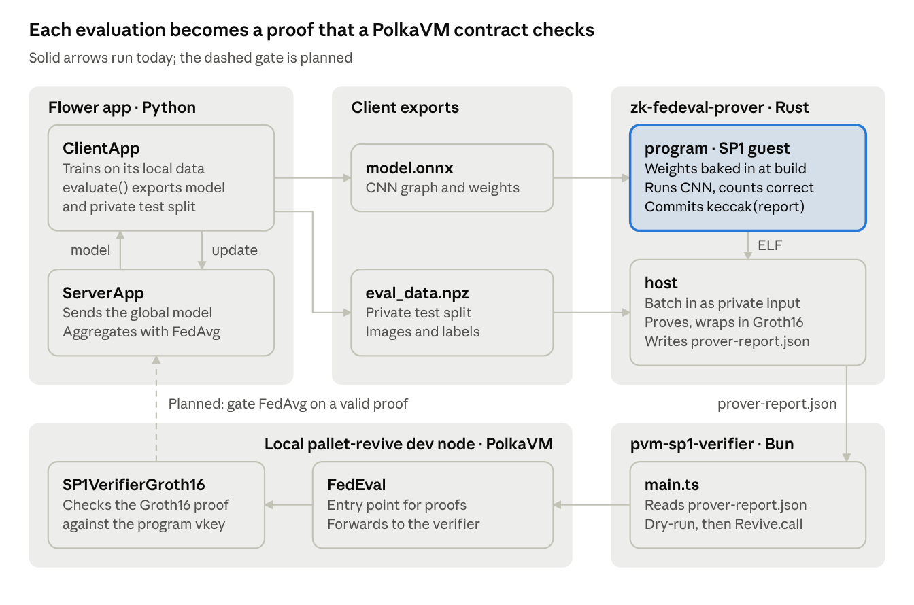

# Zk-FedEval: What It Is and How It Works

Oct 9, 2026 · @Nwele Uchenna

## TL;DR

Zk-FedEval lets a federated-learning client prove how well a model scored on its private evaluation data, without revealing that data, and lets a Polkadot/Kusama smart contract check the proof.

What works today, end to end:

1. A [Flower](https://flower.ai) simulation trains a small CNN on non-IID CIFAR-100 with 2 clients and 1 round of FedAvg.
2. A client exports the model (`model.onnx`) and its private test split (`eval_data.npz`).
3. A Rust program compiles that model into an [SP1](https://github.com/succinctlabs/sp1) zkVM guest, runs inference on a batch (16 samples by default), and produces a Groth16 proof of how many predictions were correct.
4. A TypeScript script submits the proof to an SP1 Groth16 verifier compiled to PolkaVM and deployed on a local `pallet-revive` dev node.

The pipeline is real, but slow and not yet wired into Flower: the server does not gate aggregation on proofs yet.

## The problem and the goal

Federated learning keeps data on clients, so the server can't check any metric a client reports about that data. A client can claim "my update scores 90% on my data" and the server has to take its word for it. That opens the door to poisoned updates, freeloading, and inflated claims wherever rewards depend on contribution.

The goal is to make the evaluation step verifiable: a client publishes a short proof that *this exact model*, run on *its private samples*, got *k of n* predictions right. The proof reveals nothing about the samples. The server, or a contract on chain, accepts or rejects it in milliseconds.

| Actor | Holds | Does |
| --- | --- | --- |
| Server (Flower `ServerApp`) | Global model | Sends the model out, aggregates updates with FedAvg, and should accept only updates with valid proofs |
| Client (Flower `ClientApp`) | Private train and test data | Trains locally, evaluates, and generates the proof |
| Verifier contract (PolkaVM) | Program verifying key | Checks the Groth16 proof and the public values on chain |

The original plan (`CURRENT_STATE.md`, dated 2026-08-31) was EZKL/Halo2-KZG circuits. The code has since moved to the SP1 zkVM, which runs ordinary Rust inference instead of a hand-built circuit. Leftovers from the EZKL plan remain: `ezkl` is still in `pyproject.toml`, and the wrapper contract is still named `verifierEZKL.sol`.

## System architecture

The repo holds three code bases joined by files on disk: Python produces the model and data, Rust proves the evaluation, and TypeScript submits the proof to the chain.



The only thing that crosses from the client's private world into the public one is `prover-report.json`: a verifying key, a Groth16 proof, and a 32-byte hash. The Rust workspace also has a `native` crate that runs the same Burn model outside the zkVM, as a fast sanity check.

| Path | Language | Role |
| --- | --- | --- |
| `src/zk_fedeval/` | Python | Flower `ClientApp` and `ServerApp`, the CNN, CIFAR-100 Dirichlet partitions (α = 0.5) |
| `zk-fedeval-prover/common` | Rust | `EvalBatch` and `EvalReport`, shared by guest and host |
| `zk-fedeval-prover/program` | Rust (RISC-V guest) | Inference inside SP1 |
| `zk-fedeval-prover/host` | Rust | Loads data, proves, verifies, writes the report |
| `zk-fedeval-prover/native` | Rust | Same inference without a proof |
| `pvm-sp1-verifier/` | TypeScript (Bun) | Submits the proof to the PolkaVM verifier |

## How the proof works

The proof says: "the SP1 program with verifying key `V` ran to completion and output the 32-byte hash `H`." Everything else follows from what that program does and what it bakes in.

**The model is part of the program.** At build time, `burn-import` turns `model.onnx` into Rust code and a `model.bpk` weights file. The guest embeds those weights with `include_bytes!` ([program/src/model.rs](https://github.com/Navatim-Lab/Zk-FedEval/blob/main/zk-fedeval-prover/program/src/model.rs)). Different weights produce a different ELF, so the verifying key `V` identifies the model exactly.

**The data is a private input.** The host writes an `EvalBatch` (flattened `[n, 3, 32, 32]` f32 images plus i64 labels) to the guest's stdin. That input never appears in the proof.

**What the guest computes** ([program/src/main.rs](https://github.com/Navatim-Lab/Zk-FedEval/blob/main/zk-fedeval-prover/program/src/main.rs)):

1. Read the batch and build Burn `NdArray<f32>` tensors.
2. Load the CNN from the embedded weights.
3. Run the forward pass, take `argmax` over the 100 logits, and count matches against the labels.
4. Build `EvalReport { num_samples, correct }`, SCALE-encode it, and hash it with keccak-256.
5. Commit only that 32-byte hash as the public output.

A verifier who is given the report checks `keccak256(SCALE(report)) == H`. Because the hash is committed instead of the raw report, the report itself has to travel next to the proof.

**The model.** The CNN is the Flower quickstart network (`Net` in [task.py](https://github.com/Navatim-Lab/Zk-FedEval/blob/main/src/zk_fedeval/task.py)): two 5×5 conv layers (3→6→16 channels) with ReLU and 2×2 max-pool, then three dense layers (400→120→84→100). It has about 70k parameters (\~0.27 MB) and needs about 0.66 million multiply-adds per image.

## Proving and verification pipeline

The host ([host/src/prover.rs](https://github.com/Navatim-Lab/Zk-FedEval/blob/main/zk-fedeval-prover/host/src/prover.rs)) uses `sp1-sdk` 6.6 (SP1 Hypercube) through `ProverClient::from_env()`. With no environment set, that is the local CPU prover.

1. **Setup.** `client.setup(ELF)` derives the proving key and the program verifying key `V` from the guest ELF. This runs once per model.
2. **Execute.** SP1 runs the RISC-V guest and records a trace of every instruction. The trace is split into fixed-size shards.
3. **Core proofs.** Each shard is proven separately. This is the expensive step, and its cost scales with the guest's cycle count.
4. **Recursion.** Shard proofs are folded into one compressed proof.
5. **Groth16 wrap.** The compressed proof is wrapped in a BN254 Groth16 SNARK using gnark (the `native-gnark` feature). The result is a few hundred bytes and cheap to verify on chain.
6. **Local check.** The host verifies the proof and writes `prover-report.json` with the verifying key, the proof, and the public values.

On chain ([pvm-sp1-verifier/main.ts](https://github.com/Navatim-Lab/Zk-FedEval/blob/main/pvm-sp1-verifier/main.ts)):

1. Read `prover-report.json`. Build `proofBytes` as the first 4 bytes of the Groth16 vkey hash (the verifier selector) followed by the encoded proof.
2. Encode `verifyProof(programVKey, publicValues, proofBytes)` against the `FedEval` wrapper ABI.
3. Dry-run it with `ReviveApi.call` on a local `pallet-revive` node (`ws://127.0.0.1:9944`). Abort if it reverts.
4. Submit it as a `Revive.call` extrinsic signed by the `//Alice` dev key, with 30% headroom on the dry-run weight.

`FedEval` forwards the call to `SP1VerifierGroth16`. Both are Solidity contracts compiled to PolkaVM bytecode (`.pvm` files in `contractsBytes/`). `FedEval` is deployed at `0x1249…cda5` on the dev node.

## Running it

**1. Train and export (Python, from the repo root).** The ONNX and `.npz` exports happen in the client's `evaluate` handler. The default config disables that phase (`fraction-evaluate = 0.0`), so turn it on for an export run:

```bash
uv run flwr run . local --stream \
  --federation-config="num-supernodes=2 client-resources-num-cpus=1 client-resources-num-gpus=0" \
  --run-config "fraction-evaluate=1.0 min-evaluate-nodes=2"
```

This writes `outputs/eval/partition-{0,1}/model.onnx` and `eval_data.npz`. The `.npz` holds the client's 20% local test split.

**2. Sanity-check inference natively (no proof).**

```bash
cd zk-fedeval-prover && cargo run --release -p zk-fedeval-prover
```

**3. Prove.** The guest is built from `partition-0`'s model. `native-gnark` needs a Go toolchain.

```bash
cd zk-fedeval-prover && ZK_FEDEVAL_BATCH_SIZE=16 RUST_LOG=info cargo run --release -p zk-fedeval-host
```

This prints the program verifying key, proves the first `ZK_FEDEVAL_BATCH_SIZE` samples, verifies the result, and writes `zk-fedeval-prover/prover-report.json`.

**4. Verify on chain.** This needs a local `pallet-revive` dev node on port 9944 with the verifier contracts already deployed. The deployment steps aren't in the repo yet.

```bash
cd pvm-sp1-verifier && bun install && bun run main.ts
```

**What it costs today** (measured 2026-10-09 on an M3 Max with a model of the same shape): \~81.5 M RISC-V cycles per sample plus \~32 M fixed, and even a one-sample proof runs out of memory on a 36 GB Mac (killed at a 56.5 GB peak). The [speedup plan](PROVING_SPEEDUP_PLAN.md) covers how to get to 5,000 samples a minute.

## Current limitations and open questions

The proof is sound about the computation, but it doesn't yet bind enough context to stop a dishonest client. In order of impact:

1. **The evaluation data isn't committed.** The guest never hashes its input, so a client can prove accuracy on any samples it likes, including hand-picked or relabelled ones. Fix: the client commits to a hash (or Merkle root) of its test set before training, and the guest outputs that root as a public value.
2. **The host decodes the wrong public value.** The guest commits `report_hash: [u8; 32]`, but `prover.rs` calls `proof.public_values.read::<EvalReport>()`. The "proved evaluation: x/y correct" line is therefore read from the first 8 bytes of the hash, not from the real report. The proof itself is fine. Fixed on branch `mac-int8-proving`.
3. **Nothing on chain checks the result.** `FedEval` verifies the proof, but it neither decodes the report nor compares it to a threshold. The original goal of "loss below a public threshold" isn't implemented: only accuracy is computed, and no loss.
4. **No round binding or replay protection.** The public output has no round number, nonce, or client identity, so an old proof can be resubmitted.
5. **The model is fixed at compile time.** `build.rs` hard-codes `partition-0`. Every new global model means rebuilding the ELF, a new verifying key, and a new setup. The chain must learn the expected key every round. Alternative: pass weights as input and commit their hash.
6. **Flower isn't wired in.** Proofs don't travel in Flower messages, and the server runs FedAvg without checking anything.
7. **Proving is slow.** Each image is about 0.66 M floating-point multiply-adds, and SP1 has no hardware floats, so every one is emulated in software. The companion speedup plan covers this.
8. **Housekeeping.** The prover README says CIFAR-10 (the data is CIFAR-100). `CURRENT_STATE.md` still describes the EZKL plan. `main.ts` hard-codes the contract address and the `//Alice` dev key.
